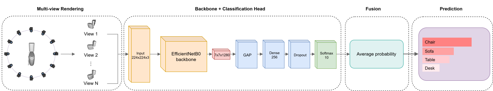
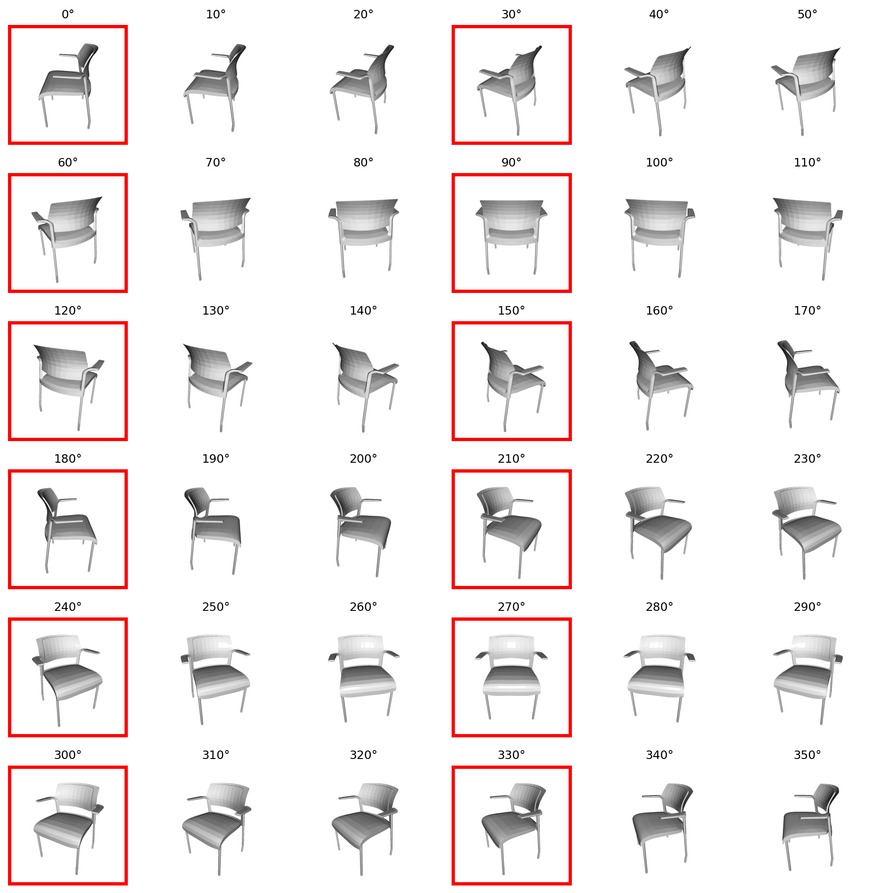
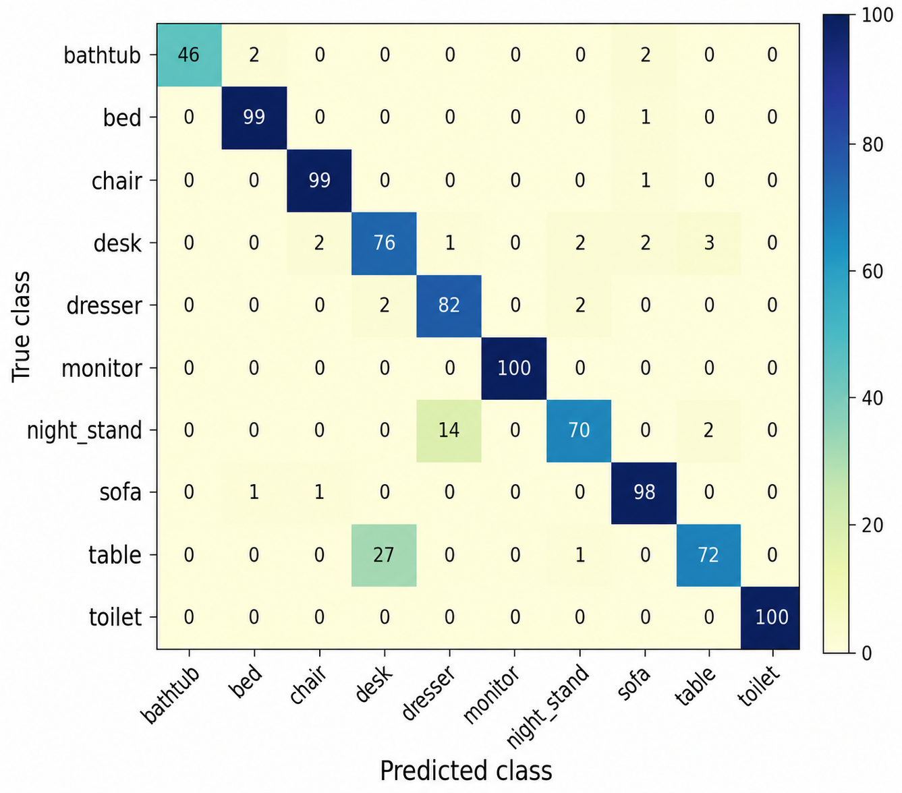

# 3D Object Classification Using Multiple 2D Projection and Convolutional Neural Networks

Code, results and figures for the paper *"3D Object Classification Using Multiple 2D Projection and Convolutional Neural Networks"*, by Gabriel Cavalcante Silva and Daniel Oliveira Dantas (Programa de Pós-Graduação em Ciência da Computação, Universidade Federal de Sergipe), SIBGRAPI 2026 (Workshop of Works in Progress).

## Content

1. [Introduction](#introduction)
2. [Pipeline](#pipeline)
3. [Dataset](#dataset)
4. [Getting started](#getting-started)
5. [Training and evaluation](#training-and-evaluation)
6. [Results](#results)
7. [Repository structure](#repository-structure)
8. [Citation](#citation)

## Introduction

3D data can be represented as point clouds, meshes, voxels or multi-view projections. This work evaluates a deliberately simple multi-view pipeline on **ModelNet10**: every 3D model is rendered into 12 or 36 2D views, each view is classified independently by a CNN, and the per-view class probabilities are averaged (decision-level fusion) to obtain the object-level prediction.

The study compares a custom CNN and EfficientNetB0 trained from scratch, EfficientNetB0 pretrained on ImageNet with a frozen base, and EfficientNetB0 with partial fine-tuning, and includes ablations on camera elevation and on the backbone (EfficientNetB0, MobileNetV2, ResNet50).

The best configuration, **EfficientNetB0 with partial fine-tuning on 12 views (Ef12)**, reaches **92.75% accuracy and 92.56% macro F1-score** on the ModelNet10 test set.

## Pipeline

<p align="center">
  
</p>

Each of the N views x_i (N = 12 or 36) goes through the same backbone h(.) and classification head g(.), producing p_i = softmax(g(h(x_i))). The object-level prediction is the arg max of the mean probability vector (1/N) sum_i p_i.

* **Backbone:** custom CNN (three blocks of two convolutions, max pooling and dropout) or the convolutional base of EfficientNetB0 (MobileNetV2 and ResNet50 in the backbone ablation).
* **Head (all models):** global average pooling, Dense(256, ReLU), Dropout(0.40), Dense(10, softmax).
* **Training:** Adam, sparse categorical cross-entropy, learning rate 1e-4, batch size 64, ReduceLROnPlateau on the validation loss, and the checkpoint with the best validation accuracy is evaluated on the test set.
* **Fine-tuning:** starting from the best frozen-base (pretrained) model, the last 30 backbone layers are unfrozen (BatchNormalization layers stay frozen) and training continues with learning rate 1e-4, the value selected by the hyperparameter search (1e-5 was the originally used value).

## Dataset

The experiments use [ModelNet10](http://modelnet.cs.princeton.edu/) (4,899 CAD models in 10 classes: bathtub, bed, chair, desk, dresser, monitor, night stand, sofa, table, toilet), obtained from [Kaggle](https://www.kaggle.com/datasets/balraj98/modelnet10-princeton-3d-object-dataset) in OFF format.

The original split (3,991 training / 908 test objects) was reorganized: the test set is unchanged and 15% of the training **objects** (seed 42) are held out for validation. All views of an object stay in the same subset, so there is no leakage between subsets.

| Set | Objects | Images (12 views) | Images (36 views) |
|---|---:|---:|---:|
| Training | 3,393 | 40,716 | 122,148 |
| Validation | 598 | 7,176 | 21,528 |
| Test | 908 | 10,896 | 32,688 |
| Total | 4,899 | 58,788 | 176,364 |

### Rendering

Each OFF model is triangulated, centered at the origin and normalized by its largest bounding-box side, then rendered with Open3D from an orbital camera (the protocol of MVCNN):

* 12 views: one every 30° (0°–330°); 36 views: one every 10° (0°–350°);
* camera elevation 30°, camera distance 3.8, zoom 0.80;
* 224x224 PNG, white background, uniform gray object, no data augmentation.

<p align="center">
  
</p>
<p align="center"><em>The 36 rendered views of the same chair. Views outlined in red are also in the 12-view configuration.</em></p>

The rendered datasets are not included in this repository because of their size; they are regenerated with the scripts below.

## Getting started

Python with TensorFlow/Keras, Open3D, NumPy, Pandas, Matplotlib and scikit-learn (Google Colab was used for training: NVIDIA T4 for the main experiments and A100 for the hyperparameter search and ablations).

```
pip install -r requirements.txt
```

**1. Download ModelNet10** and place it in the repository root as `ModelNet10/` (layout `ModelNet10/<class>/<train|test>/*.off`).

**2. Render the multi-view datasets:**

```
python scripts/render_12views.py     # -> ModelNet10_12views_224x224/
python scripts/render_36views.py     # -> ModelNet10_36views_224x224/
```

Optional arguments: `--dataset-path`, `--output-path`, `--elevation` (default 30), `--image-size`, `--camera-distance`, `--zoom`, `--limit-files-per-split` (quick test).

**3. Verify the rendered datasets:**

```
python scripts/verify_12views.py
python scripts/verify_36views.py
```

Each object folder must contain the expected number of views. Both scripts accept the dataset folder as an optional argument.

**4. Zip the datasets** (`ModelNet10_12views_224x224.zip`, `ModelNet10_36views_224x224.zip`) and upload them to Google Drive; the notebooks extract them to `/content`.

## Training and evaluation

Each experiment is one notebook in `notebooks/`. The first cells hold the configuration (dataset path, number of views, epochs, learning rates, output folder). Outputs (models, history, report and confusion matrix) are written to `OUTPUT_DIR`, named `<code>_<kind>_<model>_<views>views_<epochs>epochs`.

| Code | Notebook | Views | Model | Epochs |
|---|---|---:|---|---:|
| Cs12 | `Cs12_CNN_scratch_12views_30epochs` | 12 | Custom CNN, scratch | 30 |
| Es12 | `Es12_EfficientNetB0_scratch_12views_30epochs` | 12 | EfficientNetB0, scratch | 30 |
| Ep12 | `Ep12_EfficientNetB0_pretrained_12views_30epochs` | 12 | EfficientNetB0, pretrained (frozen base) | 30 |
| Ef12 | `Ef12_EfficientNetB0_finetuning_12views_30epochs` | 12 | EfficientNetB0, fine-tuning | 30 |
| Cs36 | `Cs36_CNN_scratch_36views_10epochs` | 36 | Custom CNN, scratch | 10 |
| Es36 | `Es36_EfficientNetB0_scratch_36views_10epochs` | 36 | EfficientNetB0, scratch | 10 |
| Ep36 | `Ep36_EfficientNetB0_pretrained_36views_10epochs` | 36 | EfficientNetB0, pretrained (frozen base) | 10 |
| Ef36 | `Ef36_EfficientNetB0_finetuning_36views_10epochs` | 36 | EfficientNetB0, fine-tuning | 10 |
| Mp12 / Mf12 | `Mp12_...`, `Mf12_...` | 12 | MobileNetV2, pretrained / fine-tuning (backbone ablation) | 30 |
| Rp12 / Rf12 | `Rp12_...`, `Rf12_...` | 12 | ResNet50, pretrained / fine-tuning (backbone ablation) | 30 |

* **Fine-tuning notebooks (Ef*, Mf12, Rf12) load the best checkpoint of the matching pretrained notebook** (Ep*, Mp12, Rp12), so run those first.
* **Camera-elevation ablation:** render the 12-view dataset with `python scripts/render_12views.py --elevation 10` (or `50`), set `RUN_TAG = "_elev10"` (or `"_elev50"`) in Ep12 and then Ef12, and run them.
* Objects are classified by averaging the class probabilities of all their views; accuracy and macro-averaged precision, recall and F1-score are computed at the object level.

## Results

### Main results (ModelNet10 test set, object level)

| Exp. | Model | Views | Accuracy | Precision | Recall | F1-score | Train time (min) |
|---|---|---:|---:|---:|---:|---:|---:|
| Cs12 | CNN scratch | 12 | 0.8051 | 0.8233 | 0.7685 | 0.7652 | 50 |
| Es12 | EfficientNetB0 scratch | 12 | 0.8987 | 0.9005 | 0.8912 | 0.8944 | 60 |
| Ep12 | EfficientNetB0 pretrained | 12 | 0.9185 | 0.9208 | 0.9175 | 0.9176 | 40 |
| **Ef12** | **EfficientNetB0 fine-tuning** | **12** | **0.9275** | **0.9326** | **0.9257** | **0.9256** | 42 |
| Cs36 | CNN scratch | 36 | 0.8040 | 0.8181 | 0.7699 | 0.7670 | 56 |
| Es36 | EfficientNetB0 scratch | 36 | 0.8789 | 0.8861 | 0.8707 | 0.8734 | 69 |
| Ep36 | EfficientNetB0 pretrained | 36 | 0.9176 | 0.9196 | 0.9173 | 0.9178 | 48 |
| Ef36 | EfficientNetB0 fine-tuning | 36 | 0.9208 | 0.9231 | 0.9202 | 0.9202 | 51 |

ImageNet pretraining, more than the architecture alone, explains the gain (Es vs. Ep), and 36 views did not beat 12 views while increasing training time.

### Hyperparameter selection (Ef12)

| Configuration | LR (frozen) | LR (fine-tune) | Batch | F1-score |
|---|---|---|---:|---:|
| Originally used | 1e-4 | 1e-5 | 64 | 0.9226 |
| Exhaustive search | 1e-4 | 1e-4 | 64 | **0.9256** |

### Camera elevation (12 views, EfficientNetB0 fine-tuning)

| Elevation | Accuracy | Precision | Recall | F1-score |
|---|---:|---:|---:|---:|
| 10° | 0.8844 | 0.8871 | 0.8769 | 0.8787 |
| **30°** | **0.9275** | **0.9326** | **0.9257** | **0.9256** |
| 50° | 0.9031 | 0.9086 | 0.9015 | 0.9015 |

### Backbone (12 views, fine-tuning)

| Backbone | Accuracy | Precision | Recall | F1-score | Parameters |
|---|---:|---:|---:|---:|---:|
| **EfficientNetB0** | **0.9275** | **0.9326** | **0.9257** | **0.9256** | 4.38M |
| MobileNetV2 | 0.9108 | 0.9184 | 0.9093 | 0.9090 | 2.59M |
| ResNet50 | 0.9185 | 0.9231 | 0.9177 | 0.9175 | 24.11M |

### Confusion matrix (Ef12)

<p align="center">
  
</p>

The main errors are between geometrically similar classes: 27 tables classified as desk, and 14 night stands vs. 2 dressers confused with each other.

### Result files

```text
results/metrics_summary.csv              main results (table above)
results/hyperparameter_selection.csv     hyperparameter search
results/ablation_elevation.csv           camera elevation ablation
results/ablation_backbone.csv            backbone ablation
results/reports/                         complete text reports per run
results/histories/                       training histories per run
results/confusion_matrices/              confusion matrices per run
results/archive_mobilenetv2/             superseded first version (MobileNetV2), kept for transparency
```

## Repository structure

```text
scripts/      Rendering (Open3D) and dataset verification scripts
notebooks/    Training and evaluation notebooks (one per experiment)
results/      Metrics, ablations, histories, reports and confusion matrices
figures/      Figures used in the paper
```

Trained models and rendered datasets are not stored in this repository because of their size.

## Citation

If you use this code, please cite:

```bibtex
@inproceedings{silva2026multiview,
  title     = {3D Object Classification Using Multiple 2D Projection and Convolutional Neural Networks},
  author    = {Silva, Gabriel Cavalcante and Dantas, Daniel Oliveira},
  booktitle = {SIBGRAPI Workshop of Works in Progress},
  year      = {2026}
}
```

The citation details will be updated once the proceedings are published.
